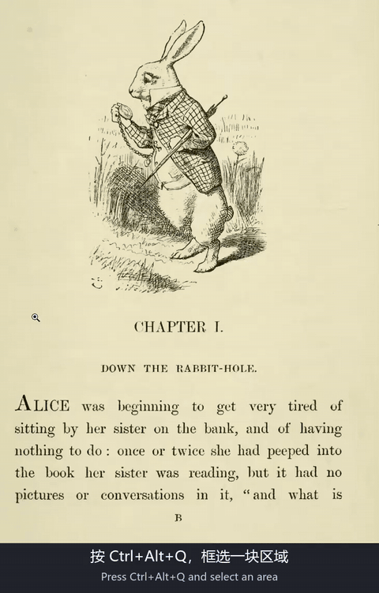

# ShotTrans

[中文](README.md) | English

**Select it, and the translation is drawn right over the original.** A screenshot translator for Windows: text in scanned PDFs, paused videos, games and app interfaces gets translated even when you can't copy it, and the layout stays intact.

Free · Portable, just unzip · Text recognition runs on your PC · English ↔ Chinese

<p align="center"></p>
<p align="center"><sub>Demo material: a scan of Lewis Carroll's <i>Alice's Adventures in Wonderland</i> (1866 edition, public domain). Not sped up.</sub></p>

**[Download the latest version](https://github.com/greypapl/shotrans/releases/latest)** (Windows 10 / 11)

## What it does

### Translate text you can't copy

Press `Ctrl+Alt+Q` and select any part of the screen: images, scans, a paused video, a game, an app's interface. The text doesn't need to be selectable.

### The translation stays in place

Headings, paragraphs and inline code are redrawn in the original layout, so you don't lose your place. Hover over a paragraph to see the original, toggle original and translation with the toolbar's "Orig/Trans" button (or Space), and double-click to copy the translation.

### Fix a word on the spot

Right-click the paragraph → "Add to glossary…", select the word and enter the translation you want. It is saved to your glossary, paragraphs that use it are retranslated right away, and it is used from then on.

### Writing papers: Chinese draft to English in one keystroke

Text you can copy doesn't need a screenshot: press `Ctrl+C`, then `Ctrl+Alt+C`, and the translation pops up next to the mouse. Chinese goes to English, using your glossary too.

### Free to use

Microsoft's free translation works without an API key. For better translations, get a free Zhipu key and use an AI model; with a dedicated GPU you can run one on your own PC with Ollama. See [Translation services](#translation-services).

## Download

Get the zip from [Releases](https://github.com/greypapl/shotrans/releases), unzip it and run `截图翻译.exe`. The program isn't signed; if Windows says it protected your PC, click "More info" → "Run anyway".

Requires Windows 10 or 11 with the OCR language packs for English and/or Chinese (Simplified). The first-run wizard checks this and explains how to add them.

## Usage

1. On first run, pick a translation service in the wizard. An AI model service is recommended (Zhipu gives free keys): enter the key and run the test. Don't want to sign up? Choose "Free: Microsoft Translator" and run the connection test.
2. Press `Ctrl+Alt+Q` (configurable) and select the area to translate.
3. Hover to see the original, double-click to copy, right-click a paragraph to retranslate with another service, right-click empty space or press `Esc` to close.
4. If a word comes out wrong, right-click that paragraph → "Add to glossary…", select the word and enter the translation you want. It is saved to the glossary and every paragraph using it is retranslated.
5. For text you can copy: press `Ctrl+C`, then `Ctrl+Alt+C` (configurable), and the translation pops up next to the mouse.

Past translations, including the screenshots, are under "History" in the tray menu.

## Translation services

An AI model is recommended: translations are better and context-aware, and glossary translations are applied more reliably.

- **Recommended, free: Zhipu GLM-4.7-Flash.** Sign up with a phone number to get a key.
- **Free, no sign-up: Microsoft Translator.** Works right away and is fast; plain machine translation, and your glossary still applies. It is not an official public service and may stop working.
- **On your own computer: Ollama (local).** Free, text never leaves your computer, works offline. For people with a dedicated GPU who care about privacy (see below).
- **Paid:** presets are included for DeepSeek, SiliconFlow, Alibaba Cloud Bailian and OpenAI, and you can use any OpenAI-compatible endpoint.

Preset models, prices and free quotas may change; check each provider's site.

**Free of charge, and not dependent on one provider:** in Settings → Translation service, use Zhipu as the primary service, another provider's free model as the backup (for example a SiliconFlow model marked free on its site), and tick "use Microsoft's free translation". Services are tried in that order; if one is unavailable the next one takes over.

### Running a model on your own computer (Ollama)

1. Download and install Ollama from [ollama.com](https://ollama.com/download).
2. In a terminal run `ollama pull qwen3:8b` (about 5.2 GB). On a modest machine use `qwen3:4b` instead (about 2.5 GB); translations will be somewhat worse.
3. In ShotTrans choose the preset "Ollama (local)", enter the model name you pulled, leave the key empty and click Test connection.

A dedicated GPU with 8 GB+ of VRAM is recommended. It also runs without one, but a screenful of text may take ten seconds or more. Small models that fit an ordinary computer don't translate as well as the cloud models.

## Data and privacy

- Screenshots are recognized locally; only the recognized text is sent to the translation service.
- API keys are stored encrypted with Windows DPAPI.
- Settings, history and screenshots are kept in `%APPDATA%\截图翻译\`. Saving screenshots can be turned off in Settings.
- If you use Microsoft's free translation (alone, or as a fallback when your AI service can't be reached), the recognized text is sent to Microsoft. It is the endpoint Microsoft Edge uses to translate pages, not an official public service, and may stop working. Off by default.

## Running from source

```
conda create -y -n shotrans python=3.12
conda activate shotrans
pip install -r requirements.txt
python -m shotrans
```

Tests: `python -m pytest -q`. Packaging and other details are in [docs/开发说明.md](docs/开发说明.md) (Chinese).

## License

MIT. Third-party licenses are in [licenses/](licenses/).
