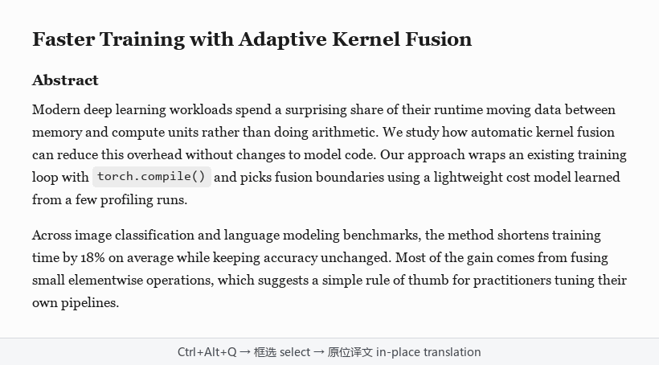

# ShotTrans

[中文](README.md) | English

A screenshot translator for Windows. Press a hotkey, select part of the screen, and the translation is drawn over the original text, keeping the layout.



## Features

- Works on screenshots, so it translates text in images, scanned PDFs, videos, games and app interfaces. The text doesn't need to be selectable.
- The translation sits where the original was, so you don't lose your place. Hover over a paragraph to see the original.
- Portable: unzip and run, no installer or account. It stays in the system tray.
- Text recognition uses Windows' built-in OCR on your machine. Translation uses a model you configure: any OpenAI-compatible API, including a local or self-hosted one.
- A glossary lets you fix how terms are translated, and inline code is kept as is.

Currently translates English to Chinese and Chinese to English.

## Download

Get the zip from [Releases](https://github.com/greypapl/shotrans/releases), unzip it and run `截图翻译.exe`. The program isn't signed; if Windows says it protected your PC, click "More info" → "Run anyway".

Requires Windows 10 or 11 with the OCR language packs for English and/or Chinese (Simplified). The first-run wizard checks this and explains how to add them.

## Usage

1. On first run, pick a translation service in the wizard, enter your API key and run the connection test.
2. Press `Ctrl+Alt+Q` (configurable) and select the area to translate.
3. Hover to see the original, double-click to copy, right-click a paragraph to retranslate with another service, right-click empty space or press `Esc` to close.

Past translations, including the screenshots, are under "History" in the tray menu.

## Translation services

Presets are included for DeepSeek, SiliconFlow, Alibaba Cloud Bailian and OpenAI, and you can use any OpenAI-compatible endpoint. Preset models and prices may change; check each provider's site.

## Data and privacy

- Screenshots are recognized locally; only the recognized text is sent to the translation service.
- API keys are stored encrypted with Windows DPAPI.
- Settings, history and screenshots are kept in `%APPDATA%\截图翻译\`. Saving screenshots can be turned off in Settings.
- Tencent TranSmart's free endpoint can be used as a fallback. It is off by default; when on, text goes to Tencent if your main service is unavailable.

## Running from source

```
conda create -y -n shotrans python=3.12
conda activate shotrans
pip install -r requirements.txt
python -m shotrans
```

Tests: `python -m pytest -q`. Packaging and other details are in [docs/开发说明.md](docs/开发说明.md) (Chinese).

## License

MIT. Third-party licenses are in [licenses/](licenses/).
