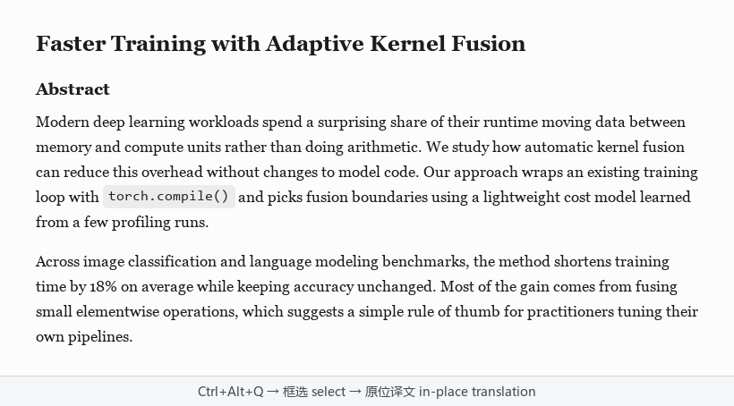

# 截图翻译

中文 | [English](README.en.md)

Windows 上的截图翻译工具。按快捷键框选屏幕上的一块区域，译文会按原来的排版盖在原文上。



## 特点

- 翻的是截图，图片、扫描 PDF、视频、游戏、软件界面里的字都能翻，不需要能复制。
- 译文就在原文的位置，读起来不用来回跳。鼠标停在某段上可以看原文。
- 绿色版，解压即用，不用安装和注册。平时只在托盘里待着。
- 文字识别用 Windows 自带的 OCR，在本机完成。翻译用你自己配置的模型，支持任何 OpenAI 兼容接口，也可以是本机或内网部署的模型。
- 可以用术语表指定译法，行内代码会原样保留。

目前支持英译中和中译英。

## 下载

到 [Releases](https://github.com/greypapl/shotrans/releases) 下载 zip，解压后运行 `截图翻译.exe`。程序没有签名，如果 Windows 提示「已保护你的电脑」，点「更多信息」→「仍要运行」。

需要 Windows 10 或 11，并装有对应语言的 OCR 语言包（英语、中文简体）。第一次运行的引导会检查，缺的话会告诉你怎么装。

## 使用

1. 第一次运行时按引导选翻译服务：没有 API key 就选「免费：微软翻译」，点一下测试连接就能用；有 key 就选大模型服务，填上 key 测试通过即可。
2. 按 `Ctrl+Alt+Q`（可改），框选要翻译的区域。
3. 译文出现后：鼠标停留看原文，双击复制，右键段落可以换个服务重翻，右键空白处或按 `Esc` 关闭。
4. 某个词翻得不对：右键那一段 →「添加术语…」，选中那个词、填上想要的译法，存进术语表后会马上重翻用到它的段落。

能复制的文字也可以不截图：先 `Ctrl+C` 复制，再按 `Ctrl+Alt+C`（可改），鼠标旁边会弹出译文。中文自动译成英文，写论文时把中文草稿翻成英文很顺手，用的也是你的术语表。

翻译记录（含截图）可以在托盘菜单的「历史记录」里查看和搜索。

## 翻译服务

推荐用大模型：翻得更好、懂上下文，术语表的「指定译法」也更可靠。

- **推荐，免费：智谱 GLM-4.7-Flash。** 用手机号注册就能拿 key。
- **免费、不用注册：微软翻译。** 装好就能用，速度快；普通机器翻译，术语表照样生效。它不是正式开放的服务，可能哪天失效。
- **在自己电脑上跑：Ollama（本机）。** 免费、文字不出电脑、断网也能用，适合有独立显卡、在意隐私的人（见下面）。
- **付费：** 内置 DeepSeek、硅基流动、阿里云百炼、OpenAI 几个预设，也可以填任意 OpenAI 兼容地址。

预设的模型、价格和免费额度可能会变，以各家官网为准。

**一分钱不花、又不怕某一家掉线**：在「设置 → 翻译服务」里，主服务选智谱，备用服务选另一家有免费模型的（比如硅基流动的免费模型，以它官网标「免费」的为准），再勾上「用微软免费翻译」。翻译时按 主服务 → 备用 → 微软 的顺序，前一个不可用就自动换下一个。

### 在自己电脑上跑模型（Ollama）

1. 到 [ollama.com](https://ollama.com/download) 下载安装 Ollama。
2. 打开命令行运行 `ollama pull qwen3:8b`（约 5.2 GB）。机器配置一般就换成 `qwen3:4b`（约 2.5 GB），翻译质量会差一些。
3. 在截图翻译里选预设「Ollama（本机）」，模型填刚才下载的名字，不用填 key，点「测试连接」。

最好有 8GB 以上显存的独立显卡。没有独显也能跑，但一屏文字可能要等十几秒以上。能在普通电脑上跑的小模型，翻译质量比不上云端的大模型。

## 数据和隐私

- 截图只在本机识别，发给翻译服务的只有识别出的文字。
- API key 用 Windows DPAPI 加密保存。
- 配置、历史记录和截图都在 `%APPDATA%\截图翻译\`。不想保存截图可以在设置里关掉。
- 选了微软免费翻译（或让它在大模型连不上时兜底），识别出的文字会发给微软。它是微软 Edge 网页翻译用的接口，不是正式开放的服务，可能哪天失效。默认关闭。

## 从源码运行

```
conda create -y -n shotrans python=3.12
conda activate shotrans
pip install -r requirements.txt
python -m shotrans
```

测试：`python -m pytest -q`。打包和其他细节见 [docs/开发说明.md](docs/开发说明.md)。

## 许可

MIT。第三方组件的许可见 [licenses/](licenses/)。
